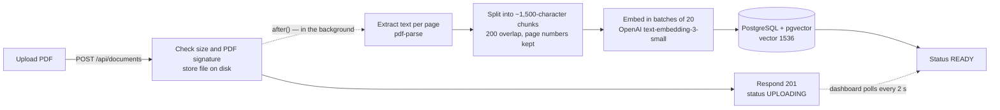
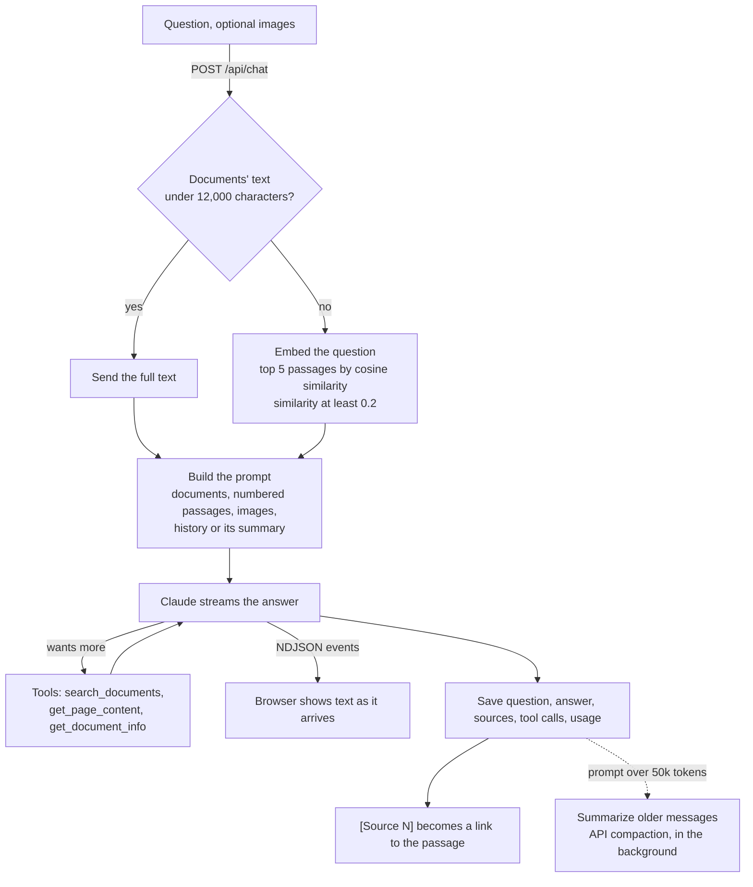

# DocuMind AI

An AI-powered document chat assistant built with Next.js, Claude and retrieval-augmented generation (RAG).

Upload PDFs, ask questions about them, and get answers grounded in your documents, with clickable citations that take you to the passage they came from. Attach screenshots, charts or photos of notes, and Claude reads those too.

## Features

- 📄 **PDF upload and processing**: drag-and-drop upload with progress, text extraction, chunking and embedding in the background, with live status
- 🧠 **RAG pipeline**: embeddings with OpenAI `text-embedding-3-small`, vector similarity search with pgvector, and the matching passages put in front of Claude
- 💬 **Real-time streaming chat** with Claude, with automatic retries (and a countdown) when the API is busy
- 🔧 **Tool calling**: Claude can search your documents again, read a specific page, or look up a document's details while answering
- 📎 **Source citations**: `[Source 2]` in an answer is a link to the passage, and every passage links to its place in the document and the PDF page
- 🗂️ **Multi-turn conversations**: full history with prompt caching, AI-generated chat titles, and automatic summarization (compaction) of long chats
- 🖼️ **Image understanding (Claude Vision)**: attach up to four images per message (paste, drop or pick), and ask follow-up questions about them later
- 🔐 **Authentication** with NextAuth (GitHub sign-in); every query is scoped to the signed-in user
- 📱 **Responsive**: full sidebar on desktop, an icon rail on tablets, a slide-out drawer on phones

## Tech stack

| Area       | Choice                                                                                             |
| ---------- | -------------------------------------------------------------------------------------------------- |
| Framework  | [Next.js 16](https://nextjs.org) (App Router, route handlers, React 19), TypeScript                |
| UI         | Tailwind CSS 4, [shadcn/ui](https://ui.shadcn.com) on Base UI, lucide icons, react-markdown        |
| Database   | PostgreSQL 16 with [pgvector](https://github.com/pgvector/pgvector), [Prisma 7](https://prisma.io) |
| Chat AI    | [Anthropic Claude](https://docs.claude.com) (Opus 5.5 for answers, Haiku 5.5 for titles)           |
| Embeddings | OpenAI `text-embedding-3-small` (1536 dimensions)                                                  |
| Files      | `pdf-parse` (pdf.js) for text, `sharp` for images, local disk storage                              |
| Auth       | NextAuth (Auth.js v4) with GitHub OAuth and JWT sessions                                           |
| Quality    | Vitest (unit + integration against a real database), ESLint, Prettier, GitHub Actions              |

## AI concepts demonstrated

| Concept                            | Where to look                                                                                                              |
| ---------------------------------- | -------------------------------------------------------------------------------------------------------------------------- |
| LLM API integration (Claude)       | [`src/lib/ai/chat.ts`](src/lib/ai/chat.ts), [`src/lib/ai/anthropic.ts`](src/lib/ai/anthropic.ts)                           |
| Streaming responses                | `generateChatReply` in `chat.ts`, NDJSON events in [`src/app/api/chat/route.ts`](src/app/api/chat/route.ts)                |
| Embeddings generation              | [`src/lib/ai/embeddings.ts`](src/lib/ai/embeddings.ts), [`src/lib/documents/embedding.ts`](src/lib/documents/embedding.ts) |
| Chunking strategies                | [`src/lib/documents/chunker.ts`](src/lib/documents/chunker.ts)                                                             |
| Vector similarity search           | [`src/lib/db/vectors.ts`](src/lib/db/vectors.ts)                                                                           |
| Retrieval-augmented generation     | [`src/lib/ai/rag.ts`](src/lib/ai/rag.ts), [`src/lib/ai/prompts.ts`](src/lib/ai/prompts.ts)                                 |
| Tool / function calling            | [`src/lib/ai/tools.ts`](src/lib/ai/tools.ts) and the tool loop in `chat.ts`                                                |
| Multi-turn conversation management | [`src/lib/chat/queries.ts`](src/lib/chat/queries.ts) (`getChatHistory`, `saveExchange`)                                    |
| Context window management          | [`src/lib/ai/context.ts`](src/lib/ai/context.ts), [`src/lib/ai/compaction.ts`](src/lib/ai/compaction.ts)                   |
| Prompt caching                     | `toCachedMessages` in `chat.ts`                                                                                            |
| Multimodal input (Vision)          | [`src/lib/ai/vision.ts`](src/lib/ai/vision.ts), [`src/lib/chat/images.ts`](src/lib/chat/images.ts)                         |
| Prompt engineering                 | `RAG_SYSTEM_PROMPT` and `buildRAGPrompt` in `prompts.ts`                                                                   |
| Error handling for AI APIs         | `describeChatError` and `withRetries` in `chat.ts`, `describeEmbeddingError` in `embeddings.ts`                            |

## Getting started

### Prerequisites

- [Node.js](https://nodejs.org) 22 or later
- [Docker](https://www.docker.com) (for PostgreSQL with pgvector), or any PostgreSQL 16 with the pgvector extension
- An [Anthropic API key](https://console.anthropic.com) and an [OpenAI API key](https://platform.openai.com) (API access is billed separately from Claude or ChatGPT subscriptions; a few dollars of credit is plenty for development)
- A [GitHub OAuth app](https://github.com/settings/developers) for sign-in, with the callback URL `http://localhost:3000/api/auth/callback/github`

### Setup

```bash
git clone https://github.com/muhammad-taha-1/documind-ai.git
cd documind-ai
npm install

# Configure: fill in the keys and secrets (each one is explained in the file)
cp .env.example .env

# Start the database and create the tables
npm run db:up
npx prisma migrate deploy
npx prisma generate

npm run dev
```

Open [http://localhost:3000](http://localhost:3000), sign in with GitHub, upload a PDF, and start a chat once it shows **Ready**.

### Scripts

| Command                    | What it does                                                         |
| -------------------------- | -------------------------------------------------------------------- |
| `npm run dev`              | Development server on port 3000                                      |
| `npm run build` / `start`  | Production build, and serving it                                     |
| `npm run lint`             | ESLint                                                               |
| `npm run typecheck`        | Generates Next.js route types, then runs the TypeScript compiler     |
| `npm run format`           | Formats everything with Prettier (`format:check` only checks)        |
| `npm test`                 | Unit tests                                                           |
| `npm run test:integration` | Integration tests against the database (needs `npm run db:up` first) |
| `npm run db:migrate`       | Creates and applies a migration after a schema change                |
| `npm run db:studio`        | Prisma Studio, to browse the data                                    |

## Architecture

### Ingesting a document



### Answering a question



### Project structure

```
src/
├── app/
│   ├── (auth)/login/         Sign-in page
│   ├── (dashboard)/          The signed-in app: documents, chats, document pages
│   └── api/                  Route handlers: documents, chat, conversations, attachments
├── components/
│   ├── chat/                 Chat view, input, messages, citations, sources, images
│   ├── documents/            Upload, document cards and pages, status
│   ├── layout/               App shell, sidebar, tablet rail, skeletons
│   └── ui/                   shadcn/ui components
├── hooks/                    useChat (streaming), useDocuments (polling), useDraftImages
├── lib/
│   ├── ai/                   Claude, embeddings, RAG, prompts, tools, compaction, vision
│   ├── chat/                 Conversation queries, validation, citations, images
│   ├── documents/            PDF parsing, chunking, embedding, processing pipeline
│   ├── db/                   Prisma client, pgvector helpers
│   └── storage.ts, rate-limit.ts, api.ts, auth.ts
├── instrumentation.ts        Startup: recovers documents interrupted by a restart
└── proxy.ts                  Redirects signed-out visitors to the login page
prisma/                       Schema and migrations
```

## Design decisions

A few choices that aren't obvious from the code alone:

- **Exact vector search, no index.** Approximate indexes (HNSW, IVFFlat) find the nearest vectors first and filter by user afterwards, so a search limited to one user's documents can come back short. An exact scan is correct and takes milliseconds at this scale.
- **Thresholds were measured, not guessed.** On real documents, correct passages scored 0.24–0.67 and unrelated questions at most 0.19, so passages below 0.2 are dropped and those under 0.3 are flagged as a loose match. Relevance is shown as a label, because similarity ranks passages well but isn't a calibrated confidence.
- **Small documents are sent whole.** Below 12,000 characters, the full text costs little more than five passages and answers questions about the whole document ("is this resume good?") that no single passage matches.
- **A hand-written tool loop** (rather than the SDK's tool runner), so tool progress can stream to the browser, passages found by tools continue the citation numbering, and Claude is made to answer after five rounds.
- **Compaction instead of a sliding window.** A sliding window changes the start of the prompt every turn, which defeats prompt caching. The whole conversation is sent until it passes 50k tokens; then the API summarizes the older part, and the prompt stays a stable prefix between summaries.
- **Images are normalized on upload** with `sharp`: the real format is checked, phone photos are rotated upright, images are scaled to the largest size Claude actually uses, and metadata (such as GPS) is removed. Earlier images are sent again with later messages, newest first, within the API's request limits.
- **Single-server assumptions, stated.** Uploads live on local disk, background work runs in the server process (`after()`), and rate limits are counted in memory. Running several instances would need shared storage, a job queue and a shared rate-limit store.

## Error handling and limits

- Problems with a request are JSON errors with the right status (`400`, `401`, `404`, `411`, `413`, `415`, `429`). Anything unexpected is logged and answered with a `500` and a generic message, never internal details.
- Claude being rate-limited or overloaded is retried automatically, with a countdown in the chat. Other AI failures get specific messages (service at capacity, conversation too long, misconfigured key).
- Document processing failures explain themselves: image-only or damaged PDFs, a missing file, embedding quota or outage. **Retry** reprocesses the document.
- Per-user rate limits: 20 messages, 10 uploads and 10 retries a minute.
- Documents left mid-processing by a server restart are marked as failed at startup, so they can be retried instead of spinning forever.

## Testing

```bash
npm test                  # unit tests
npm run db:up             # integration tests need the database
npm run test:integration  # route handlers and queries against real PostgreSQL
```

Integration tests use the real database and real file storage (in a temporary folder) and replace only the AI APIs. They run with placeholder API keys, so a call that isn't replaced fails instead of spending credits. The CI workflow ([`.github/workflows/ci.yml`](.github/workflows/ci.yml)) runs lint, the format check, typecheck, both test suites and a production build. It's currently started by hand from the Actions tab.

## Screenshots

<!--
  Screenshots go in docs/screenshots/ (see the list there). Once they're added, uncomment:


-->

_Screenshots are coming soon._

## Known limitations

- Scanned (image-only) PDFs aren't OCR'd; they're reported as having no extractable text.
- NextAuth v4 has open advisories affecting email sign-in and Auth.js's `getToken`, neither of which this app uses. The fix is a migration to Auth.js v5.
- Designed for a single server instance (see Design decisions).
